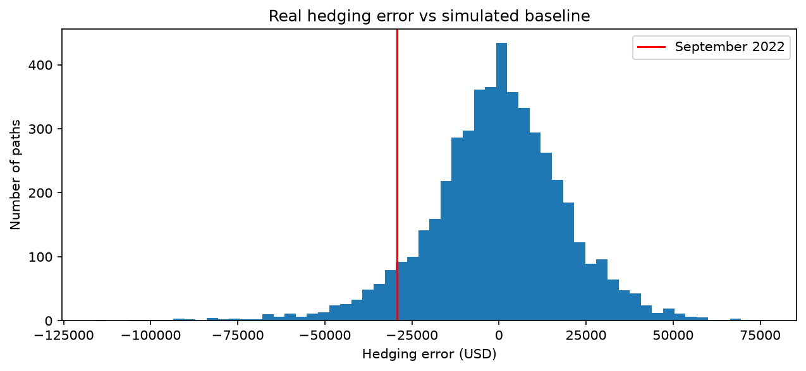

# Delta Hedging a GBP/USD Option Through the 2022 Mini-Budget

When I started sixth form back in 2022, I kept seeing on the news how the UK mini-budget caused a sharp drop in sterling. At that point, I had virtually zero quantitative finance knowledge to understand the market dynamics behind it. Four years later, I am revisiting this event by applying mathematical and financial concepts I have learned over time to FX options, an asset class that I wish to explore further, and to examine how well delta hedging manages exposure during sharp exchange-rate moves.

## Question
How effective is delta hedging for a GBP/USD option during a period of extreme exchange-rate volatility?

## Data
- GBP/USD spot (`DEXUSUK`) and US effective fed funds rate (`DFF`) from FRED
- UK Bank Rate from the Bank of England, entered manually
- Data range: July 2022 - October 2022 (daily)

## Method
- First, I priced a 1-month ATM-forward GBP put using the Garman–Kohlhagen model and a 21-day historical volatility of 9.08%. Then I tested this pricer with put–call parity before calculating and checking the Greeks (Δ, Γ, ν, Θ) against finite-difference estimates.
- Next, I delta-hedged a $10m notional daily along the actual spot path and ran the same hedge on 5,000 simulated GBM paths as a Monte Carlo baseline for the real-world result.
- Finally, I used Brent's method with SciPy to solve for break-even volatility.

## Results

The table below shows all quantified results from the project: the various volatility results and the hedging error of the real path compared to the Monte Carlo baseline.

| Metric | Value |
|---|---|
| Priced volatility | 9.08% |
| Break-even volatility | 14.55% |
| Realised volatility | 18.35% |
| Hedging error (real path) | −$29,292 (−28% of premium) |
| vs. Monte Carlo baseline | −1.45σ; 7.1% of simulated paths did worse |



## Key finding

The main finding was that from tracking the Greeks over the option's life, the largest hedging losses occurred in the weeks leading up to the mini-budget.

High gamma meant delta changed quickly with each move in spot, so the daily hedge kept falling out of date. However, the sharp fall in sterling was not the main source of losses. The put was deep in the money by then and its gamma had collapsed, so the hedge practically moved one-for-one with the option. This explains why the break-even volatility (14.55%) was lower than the realised volatility (18.35%).

## Limitations

As I deliberately kept the scope of the project small, there were many limitations in this project, both from modelling assumptions and project design choices:

- **Model Assumptions**: Garman-Kohlhagen is the FX extension to Black-Scholes, so the same assumptions carry over. This includes constant volatility, constant interest rates over the option's life and continuous hedging with no transaction costs.

- **Design Choices**: I chose a 21-day historical volatility to price the option, rather than the actual market-implied volatility, which is what real desks would use. Also, the real-world result comes from a single historical path, so it describes one episode rather than a general result.

## How to run

```
pip install -r requirements.txt
```

Then open `gbpusd_minibudget.ipynb` and run all cells.